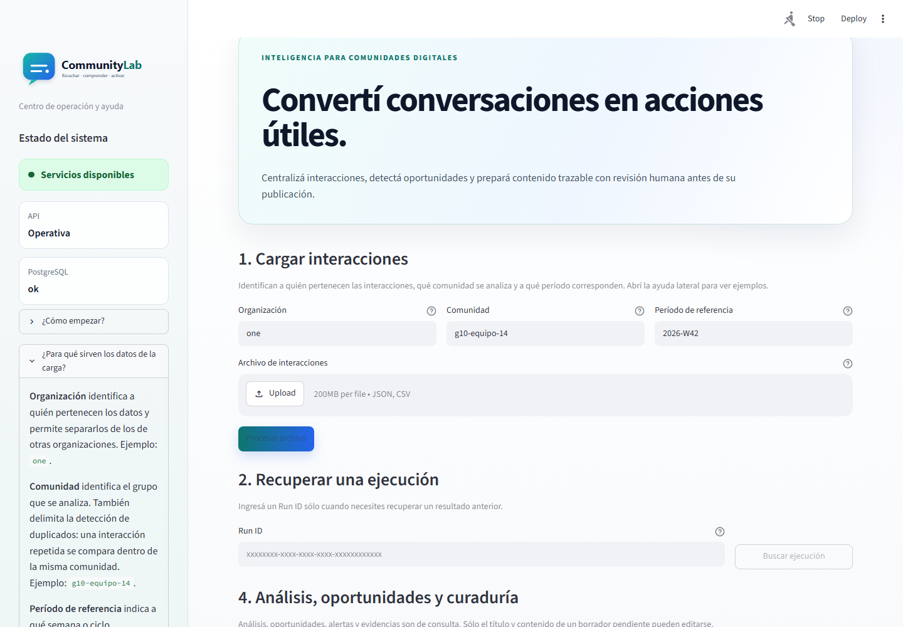
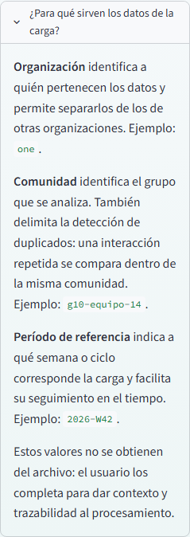
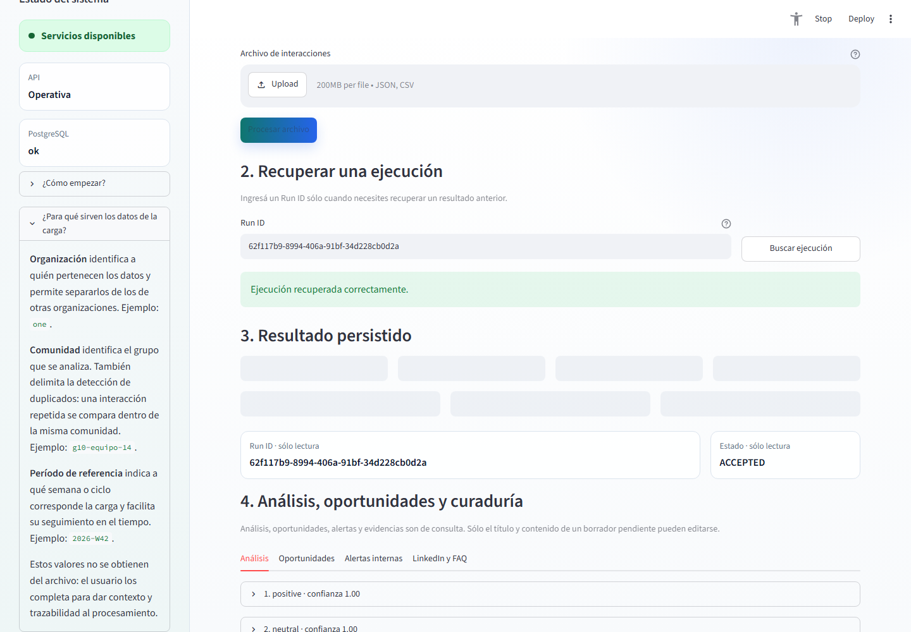
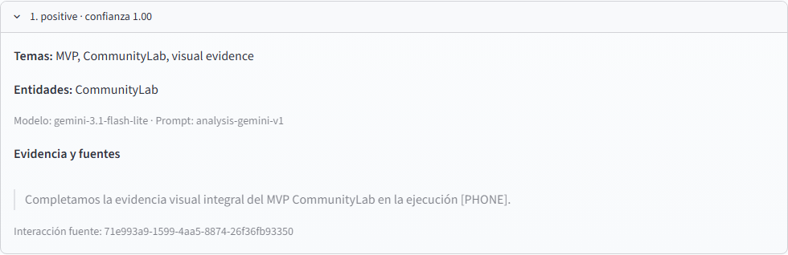
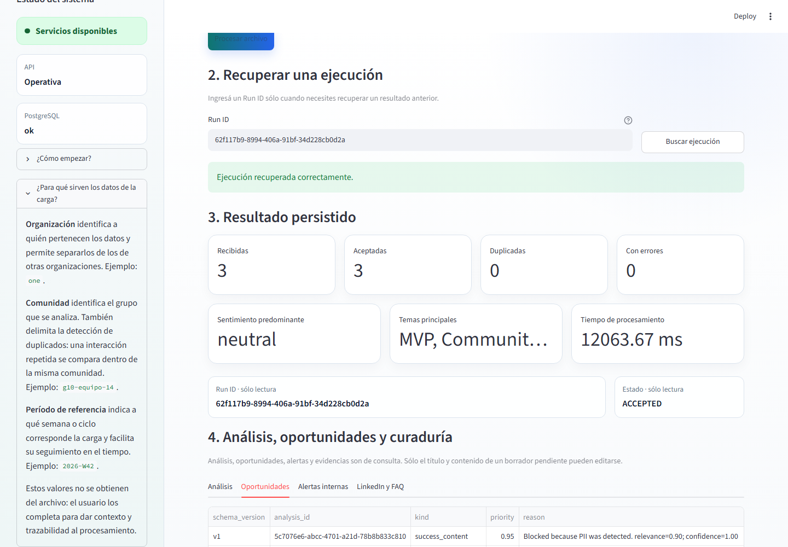
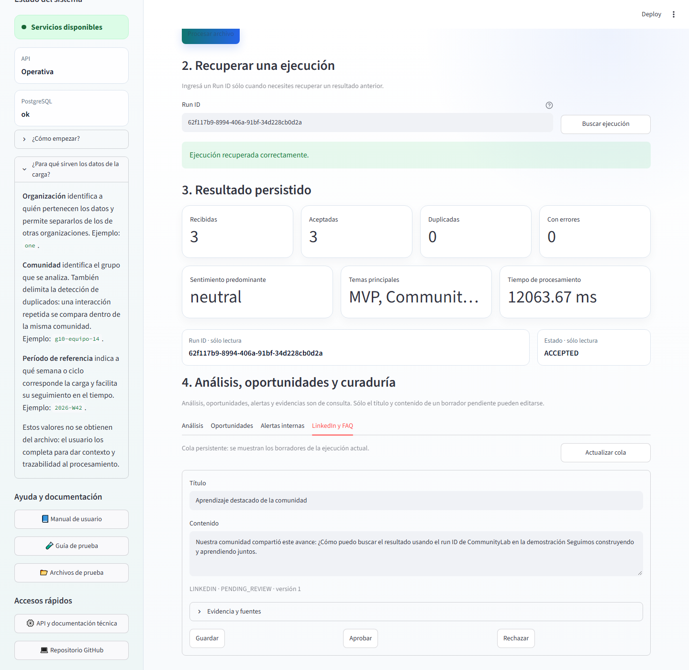
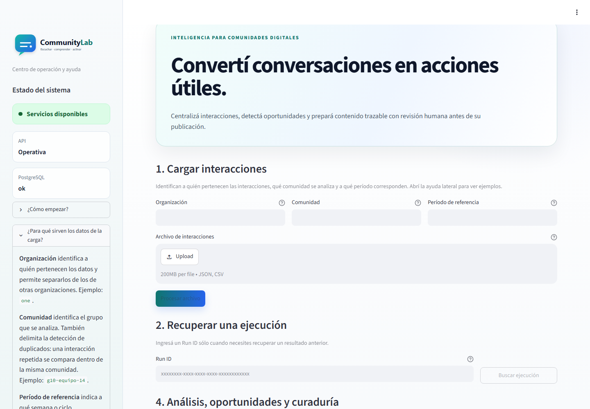

# Evidencia paso a paso del dashboard renovado

Fecha de captura: 17 de octubre de 2026.

Estas capturas verifican la identidad visual, la ayuda contextual, la distinción
entre entradas funcionales e información de solo lectura, y la conservación del
recorrido funcional de CommunityLab.

Organización, Comunidad y Período de referencia **sí son parámetros de entrada**:
el usuario los completa para identificar, separar y dar trazabilidad a la carga.
En cambio, las métricas, el Run ID, el estado, los análisis, las oportunidades,
las alertas y las fuentes son **información de consulta** y no aceptan edición.
Dentro de la cola de curaduría sólo se pueden modificar el título y el contenido
de un borrador pendiente.

## Recorrido reproducido

1. Abrir el dashboard local con API y PostgreSQL saludables.
2. Revisar la ayuda que explica Organización, Comunidad y Período.
3. Recuperar el Run ID `62f117b9-8994-406a-91bf-34d228cb0d2a`.
4. Confirmar el resumen y los metadatos de solo lectura.
5. Abrir un análisis y verificar sus fuentes.
6. Consultar las oportunidades persistidas.
7. Consultar la cola de curaduría LinkedIn/FAQ.
8. Confirmar la misma identidad y ayuda en el despliegue público.

## Índice de capturas

| Paso | Archivo | Evidencia |
| --- | --- | --- |
| 1 | `01-dashboard-home.png` | Portada, identidad, health y entradas funcionales. |
| 2 | `02-contextual-help.png` | Ayuda lateral completa con finalidad y ejemplos de cada parámetro. |
| 3 | `03-run-result.png` | Ejecución recuperada, métricas y metadatos de solo lectura. |
| 4 | `04-analysis-evidence.png` | Análisis Gemini con modelo, prompt y fuente visible. |
| 5 | `05-opportunities.png` | Tabla de oportunidades y reglas de decisión. |
| 6 | `06-curation-queue.png` | Borrador persistente editable dentro de la cola de curaduría. |
| 7 | `07-public-deployment.png` | Versión pública en Render con la nueva experiencia visual. |

## Evidencia visual paso a paso

### Paso 1 — Portada, estado y entradas funcionales



### Paso 2 — Ayuda contextual completa



### Paso 3 — Ejecución recuperada y datos de solo lectura



### Paso 4 — Análisis con evidencia y fuente



### Paso 5 — Oportunidades persistidas



### Paso 6 — Cola de curaduría



### Paso 7 — Despliegue público



Los datos pertenecen al set controlado de evidencia del proyecto. Las capturas
no contienen credenciales, secretos ni datos personales reales.

## Regeneración

Con Docker Compose en ejecución, Microsoft Edge y Node.js disponibles:

```powershell
npm install --no-save --no-package-lock @playwright/test@1.56.1
npx playwright test scripts/capture_dashboard_evidence.spec.js --workers=1 --reporter=line
```

El script vuelve a recorrer la ejecución controlada, reemplaza las capturas
vigentes E1, E3, E4, E5 y E8, y genera este conjunto completo. Las evidencias
OpenAPI y del recibo local se conservan porque su interfaz técnica no cambió.

Trazabilidad: GitHub #219 · PR #220 · release PR #221.
