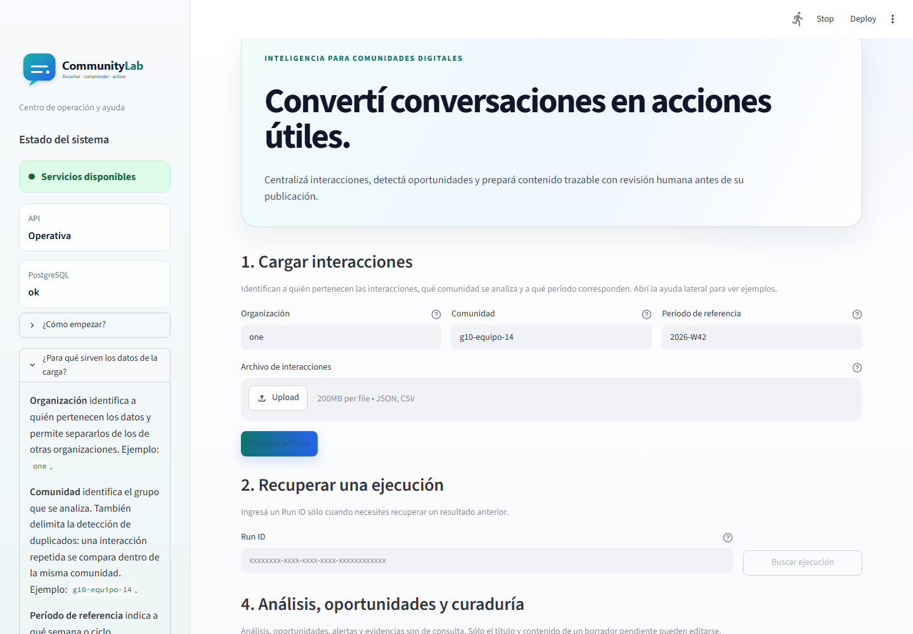
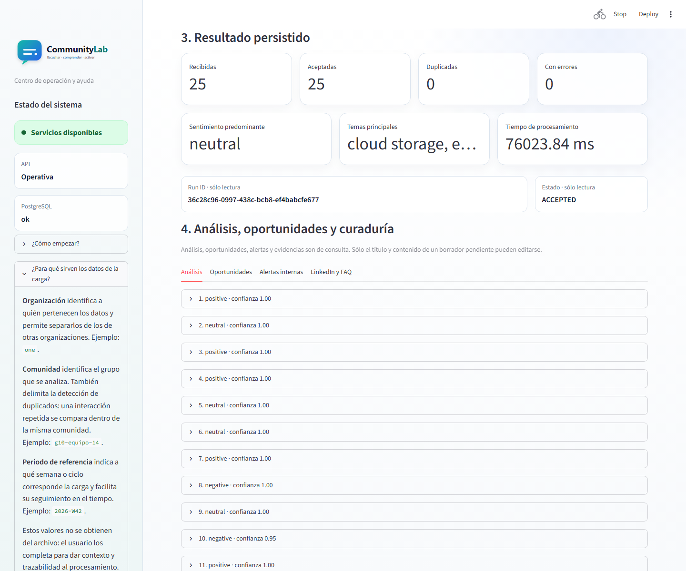
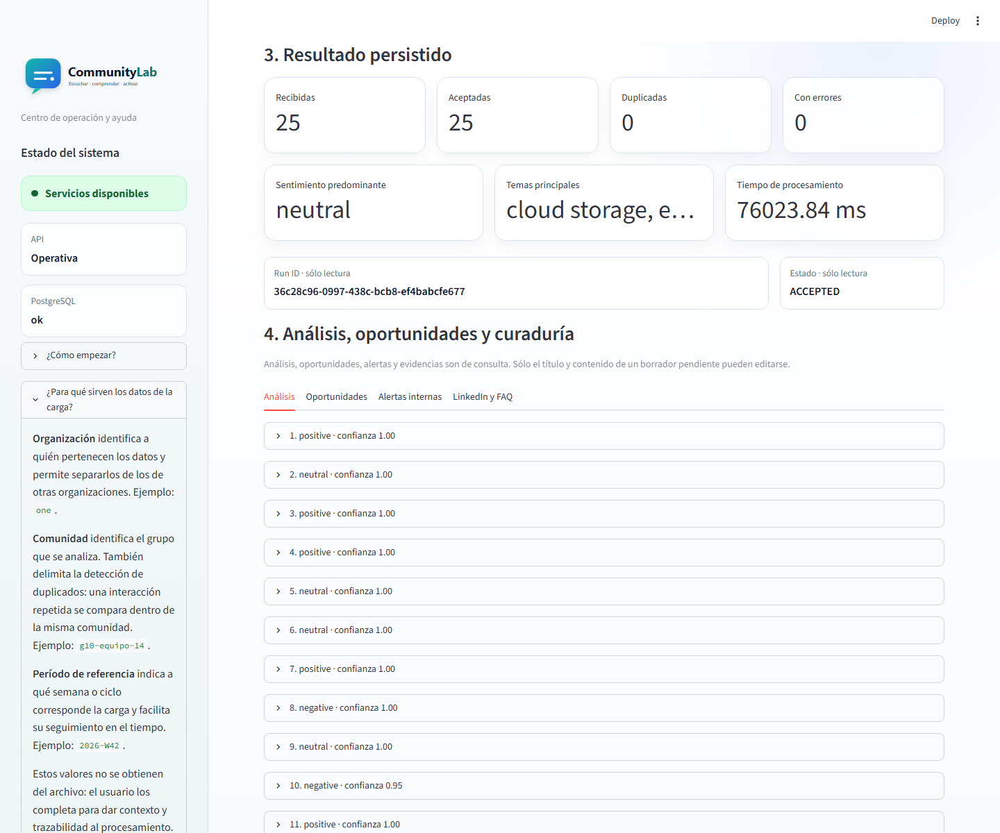
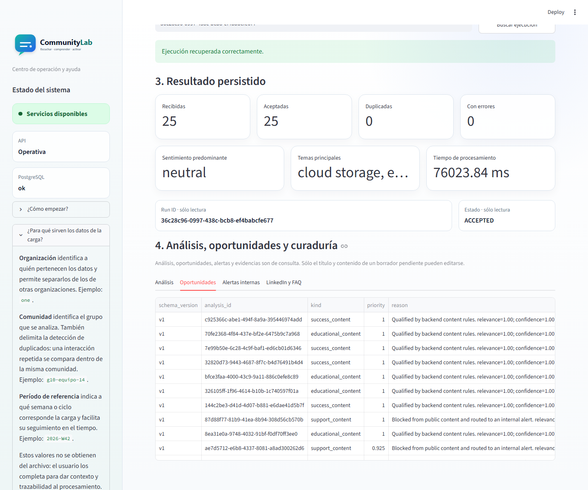
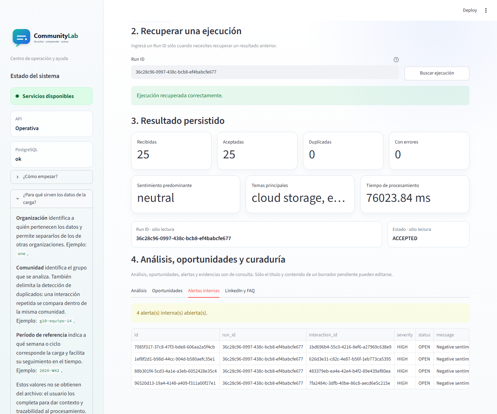
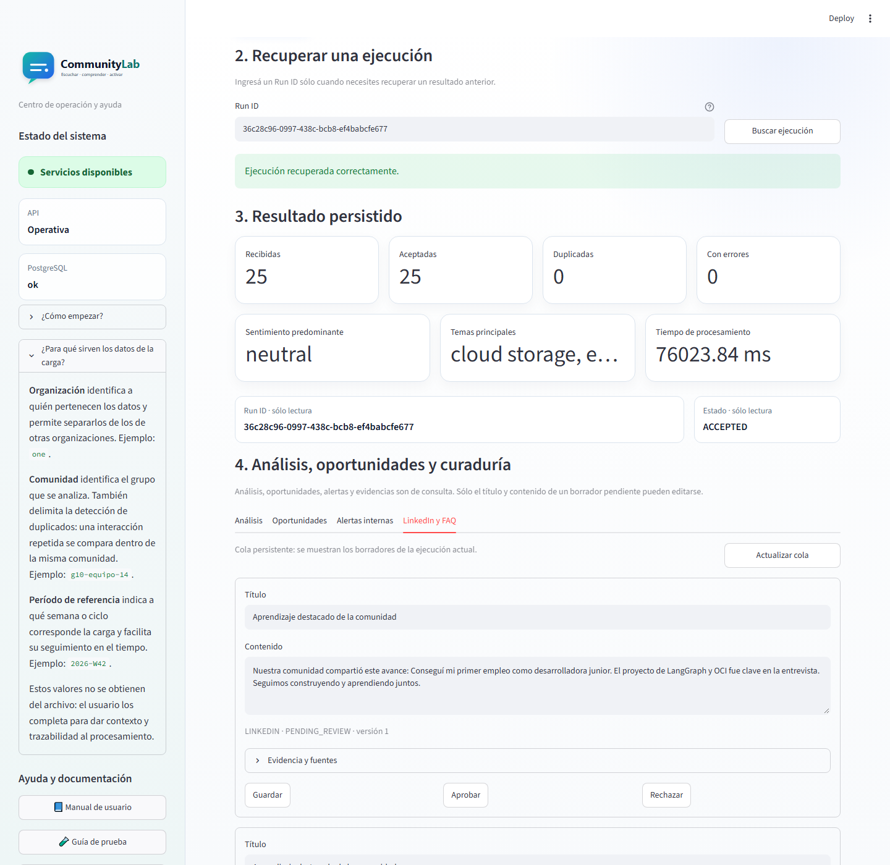

# Sets de prueba adicionales de CommunityLab

Esta carpeta contiene cuatro conjuntos independientes. Los archivos originales de `communitylab_ejemplos` no fueron modificados.

Para saber exactamente qué archivos cargar, en qué orden y qué verificar,
consultar la [guía paso a paso de prueba funcional](GUIA_PRUEBA_FUNCIONAL.md).
Los archivos `salida_*` y `manifest*` sirven como referencia y no deben cargarse
en el dashboard.

| Set | Tema | Registros | Análisis esperados | Oportunidades | Activos |
|---|---|---:|---:|---:|---:|
| 01 | Empleabilidad y formación tecnológica | 60 | 60 | 40 | 12 |
| 02 | Producto SaaS y comunidad de desarrolladores | 60 | 60 | 40 | 12 |
| 03 | Sostenibilidad e impacto social | 60 | 60 | 40 | 12 |
| 04 | Prueba funcional inicial multiescenario | 25 | Variable | Variable | Variable |

Los sets 01–03 incluyen `entrada_60.json`, `salida_esperada_60.json` y
`manifest.json`. El set 04 incluye la misma entrada en JSON y CSV, una salida
procesada ilustrativa, un manifest de ejemplo y su propio README.

## Distribución de casos por set

- 10 logros o testimonios.
- 10 preguntas técnicas.
- 10 comentarios positivos.
- 10 problemas o feedback negativo.
- 10 mensajes neutros que no deben generar contenido.
- 10 mensajes sensibles que deben bloquearse por privacidad.

## Criterios esperados

- Los 60 registros producen un análisis.
- Los mensajes neutros no crean oportunidades.
- Los casos sensibles quedan bloqueados.
- Todos los activos contienen `source_interaction_ids`.
- Las salidas incluyen resumen, oportunidades, activos y rutas esperadas de OCI.

## Mejora implementada: compatibilidad del contrato de entrada

La API mantiene los siguientes nombres como contrato canónico:

| Dato | Nombre canónico | Alternativas admitidas |
|---|---|---|
| Autor | `author` | `author_alias`, `autor` |
| Canal | `channel` | `canal` |
| Tipo de interacción | `type` | `interaction_type`, `tipo` |
| Contenido | `text` | `texto` |

Los tipos documentados en español se normalizan antes del análisis. Algunos
ejemplos son:

| Valor recibido | Valor normalizado |
|---|---|
| `pregunta_tecnica` | `question` |
| `testimonio` | `achievement` |
| `proyecto_destacado` | `achievement` |
| `conversacion` | `message` |
| `problema` o `feedback_negativo` | `problem` |
| `alerta_privacidad` | `privacy_alert` |

La carga CSV admite UTF-8, que continúa siendo la codificación recomendada, y
Windows-1252 para archivos exportados por herramientas de escritorio. También
acepta fechas con formato ISO 8601 o `DD/MM/YYYY HH:MM`.

Esta compatibilidad está cubierta por pruebas automáticas que validan los cuatro
archivos JSON de entrada y las 25 filas del CSV del set 04. Las salidas esperadas
son referencias funcionales: los valores de relevancia, confianza y cantidades
de oportunidades o activos pueden variar cuando se utiliza un modelo LLM real.

### Evidencia paso a paso

La prueba funcional se ejecutó el 16 de octubre de 2026 con
`set_04_prueba_inicial/entrada_interacciones_25.json` y el proveedor Gemini. La
ejecución persistida fue `36c28c96-0997-438c-bcb8-ef4babcfe677`.

Las seis capturas se renovaron el 17 de octubre de 2026 con la interfaz actual
del dashboard. Organización, Comunidad y Período de referencia son entradas
funcionales de la carga; las métricas, el Run ID, el estado, los análisis, las
oportunidades y las alertas son datos de consulta. En curaduría sólo se pueden
editar el título y el contenido de cada borrador pendiente.

Resultado consolidado:

- Estado `ACCEPTED`.
- 25 interacciones recibidas y aceptadas.
- 0 duplicados y 0 errores.
- 25 análisis y 25 oportunidades detectadas.
- 15 activos generados para revisión.
- 4 alertas internas.
- Tiempo total aproximado: 76 segundos.

#### 1. API y PostgreSQL disponibles



#### 2. Ejecución recuperada y resumen persistido



#### 3. Análisis de las 25 interacciones



#### 4. Oportunidades detectadas



#### 5. Alertas internas por sentimiento negativo



#### 6. Activos de LinkedIn y FAQ listos para curaduría

La cola se filtra por el `run_id` actual para evitar mezclar los borradores de
otras pruebas almacenadas en PostgreSQL.



#### Regenerar estas evidencias

Con Docker Compose, Microsoft Edge y Node.js disponibles:

```powershell
npm install --no-save --no-package-lock @playwright/test@1.56.1
npx playwright test scripts/capture_test_set_evidence.spec.js --workers=1 --reporter=line
```
